# 表情包画廊

18 张现成网络图，经逐张目视筛选。中文台词图与无字鬼脸分开标记，原字节和水印保留；鹿语录长图按一张计数。

## 会赢的

自信、立旗、嘴硬。语言：中文；剧透：低。

[来源](https://k.sina.com.cn/article_6186522756_170bed884020015j51.html) · [原图直链](https://k.sinaimg.cn/n/sinakd20240305s/557/w640h717/20240305/e03f-1d96c4156f9c58243b53b07734d39ce2.jpg/w700d1q75cms.jpg?by=cms_fixed_width)

## 你才是挑战者哦

主动应战、反客为主。语言：中文；剧透：低。

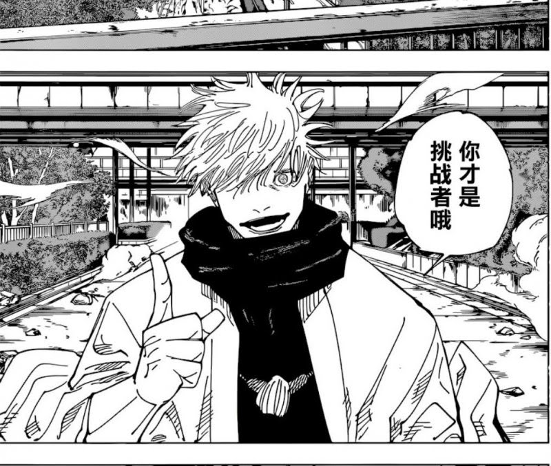

[来源](https://memes.tw/wtf?template=58999) · [原图直链](https://memeprod.ap-south-1.linodeobjects.com/user-template/35271bde2a05ff95d8f552e7ab597286.png)

## 考前／考后

考试、提前庆功、翻车。语言：中文；剧透：高。

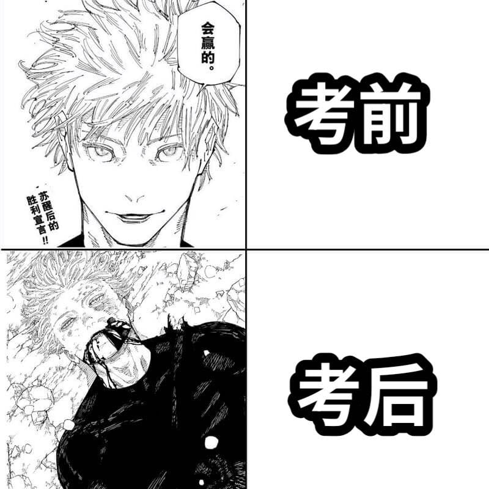

[来源](https://www.dcard.tw/f/jujutsu_kaisen/p/256904833) · [原图直链](https://megapx-assets.dcard.tw/images/c87c5710-213d-42e1-8c48-40695b950abc/orig.jpeg)

## 急了

双方轻松互损、用户已在玩嘴硬梗。语言：中文；剧透：低。

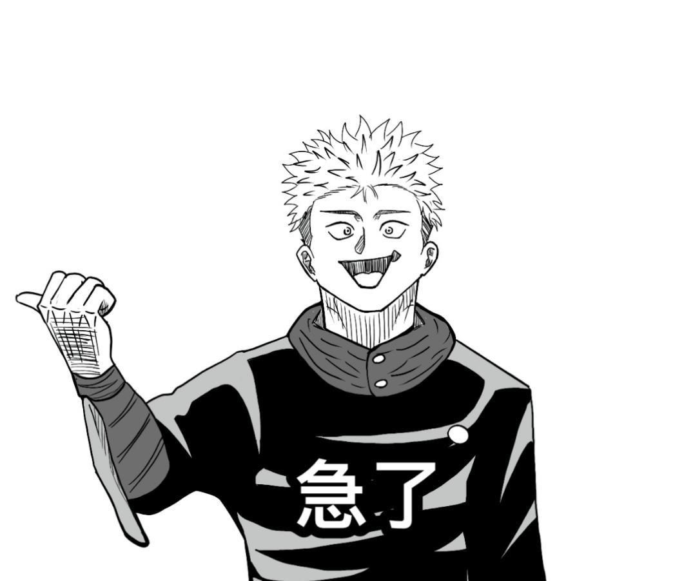

[来源](https://forum.gamer.com.tw/Co.php?bsn=48102&sn=19045) · [原图直链](https://truth.bahamut.com.tw/s01/202404/forum/48102/f8be33e092f9ac6c63eabeefb4eeab09.JPG)

## 但这是废物的思维

很有见地的下半句、头铁反转。语言：中文；剧透：低。

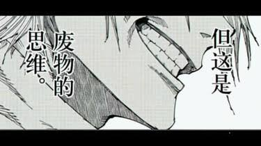

[来源](https://disp.cc/b/ACG/ic0d) · [原图直链](https://images.plurk.com/3WiiJjRHse6iXQH6izbbbJ.png)

## 两者皆有可能，这就是答案

两头押注、废话式总结。语言：中文；剧透：低。

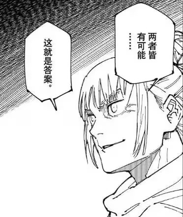

[来源](https://disp.cc/b/ACG/ic0d) · [原图直链](https://i.imgur.com/PIWXf7g.jpeg)

## 鹿语录长图

用户索要语录合集时发，日常优先选单格。语言：中文；剧透：高。

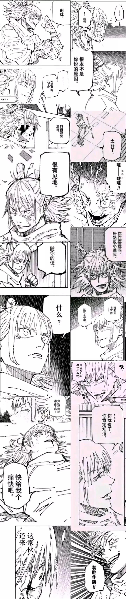

[来源](https://disp.cc/b/ACG/ic0d) · [原图直链](https://i.imgur.com/gjwTfDP.jpg)

## 火影跨圈的废物思维

用户已引出火影跨圈梗、漫画人物头铁反串。语言：中文；剧透：中。

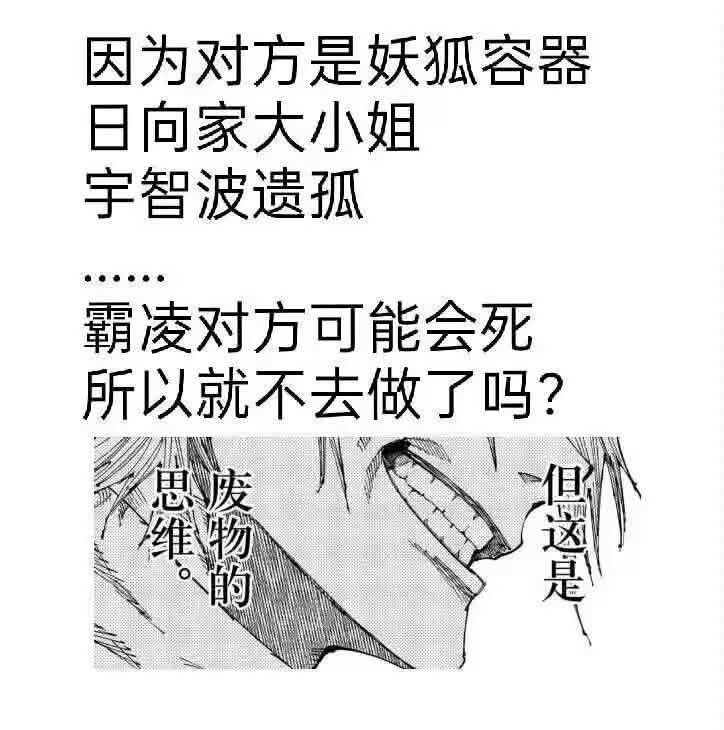

[来源](https://disp.cc/b/ACG/ic0d) · [原图直链](https://i.imgur.com/3Sy5mQp.jpeg)

## 猫虎头铁反转

故意挑战高难度、嘴硬后行动；长图。语言：中文；剧透：低。

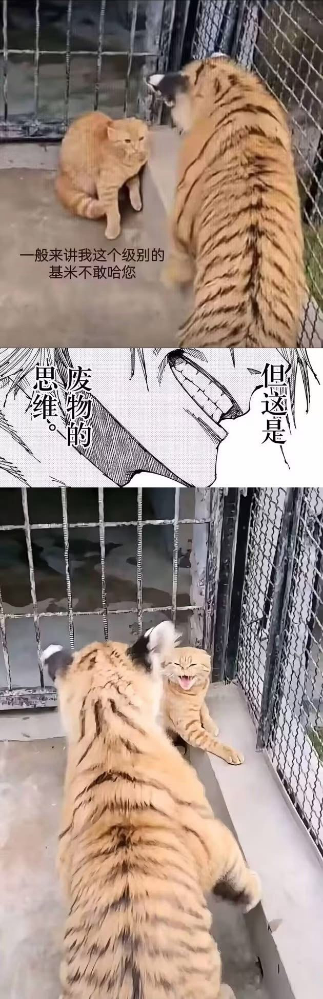

[来源](https://disp.cc/b/ACG/ic0d) · [原图直链](https://i.verb.tw/7tOq17ru.jpg)

## 脑花斜眼阴笑

看穿小算盘、暗中整活。语言：无字；剧透：低。

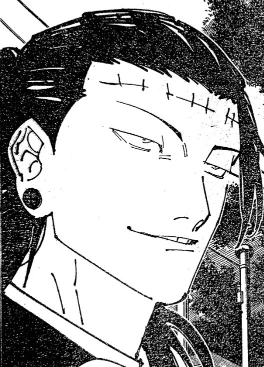

[来源](https://k.sina.com.cn/article_3115259807_b9af179f040015no6.html) · [原图直链](https://k.sinaimg.cn/n/sinakd20231018ac/461/w528h733/20231018/f38f-b881118b01c5f63226d225a7f04f01ec.jpg/w700d1q75cms.jpg?by=cms_fixed_width)

## 脑花惊呆

突发荒诞结果、夸张震惊。语言：感叹号；剧透：低。

[来源](https://k.sina.com.cn/article_3115259807_b9af179f040015no6.html) · [原图直链](https://k.sinaimg.cn/n/sinakd20231018ac/740/w903h1437/20231018/6b06-b3e2b3f5bef6ebca0a8b21cc868c0553.jpg/w700d1q75cms.jpg?by=cms_fixed_width)

## 脑花仰头憋笑

绷住表情管理、离谱方案。语言：无字；剧透：低。

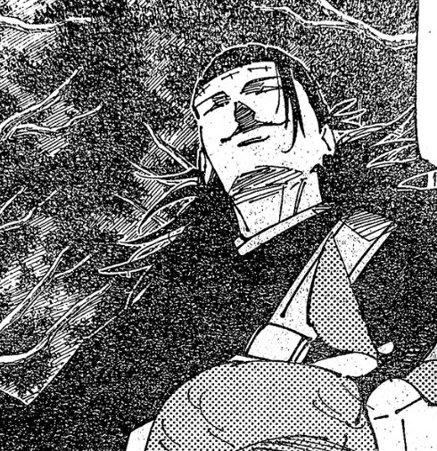

[来源](https://k.sina.com.cn/article_3115259807_b9af179f040015no6.html) · [原图直链](https://k.sinaimg.cn/n/sinakd20231018ac/196/w490h506/20231018/8eee-5cdcaa5a284ef300e8ca08cace1304ba.jpg/w700d1q75cms.jpg?by=cms_fixed_width)

## 脑花侧眼怀疑

听完抽象计划、沉默审视。语言：无字；剧透：低。

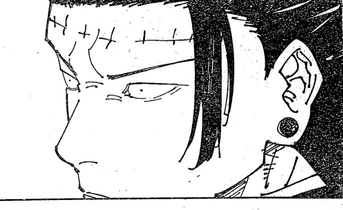

[来源](https://k.sina.com.cn/article_3115259807_b9af179f040015no6.html) · [原图直链](https://k.sinaimg.cn/n/sinakd20231018ac/307/w686h421/20231018/8815-bceb61582527004268c43458f9dfd7a7.jpg/w700d1q75cms.jpg?by=cms_fixed_width)

## 要忍耐

忍笑、憋住吐槽。语言：中文；剧透：低。

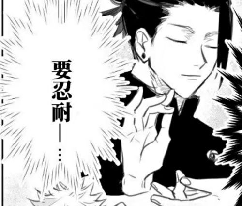

[来源](https://m.duitang.com/blog/?id=1317820189) · [原图直链](https://c-ssl.dtstatic.com/uploads/blog/202101/20/20210120214238_8c75d.thumb.700_0.jpg)

## 那我就是大义

接“我们可是纯爱”、价值立场反串。语言：中文；剧透：低。

[来源](https://forum.gamer.com.tw/C.php?bsn=71515&snA=1462) · [原图直链](https://truth.bahamut.com.tw/s01/202412/forum/71515/ac396cdca9e989809623e99f77d8d327.JPG)

## 抱歉了，虎杖

轻松道歉；此图是另一个剧情场景，自责长文走文字。语言：中文；剧透：中。

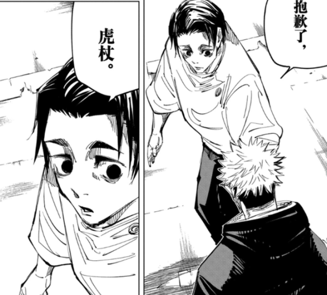

[来源](https://k.sina.cn/article_1836249987_6d72f3830010123x5.html) · [原图直链](https://n.sinaimg.cn/sinakd20220518ac/419/w641h578/20220518/5dcd-be56329fd0d5d5bc1b7d18b13d2c1983.png)

## 我打宿傩吗

临时接锅、突然被安排高端局。语言：中文；剧透：高。

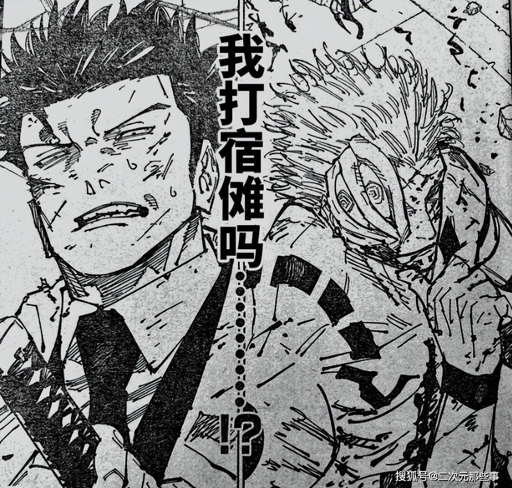

[来源](https://www.sohu.com/a/762780547_634164) · [原图直链](https://q7.itc.cn/images01/20240308/df8fcfd7ca004c4db97dbbe7c51f3a0d.jpeg)

## 宿傩大人可还没有动真格

优势已丢仍嘴硬、赛后找补。语言：中文；剧透：高。

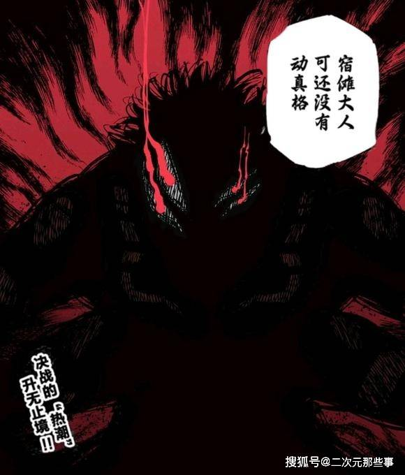

[来源](https://www.sohu.com/a/762059647_634164) · [原图直链](https://q9.itc.cn/images01/20240305/187fff2fdb194313aeaa794aa3fe3254.jpeg)
